<h1 align="center">Elaris Color Theme</h1>

  

  <strong>A refined color theme for a calmer, more focused coding experience.</strong>

  Thoughtfully balanced colors, restrained accents, and cohesive syntax highlighting — designed to bring clarity and visual harmony to your everyday development workflow.

  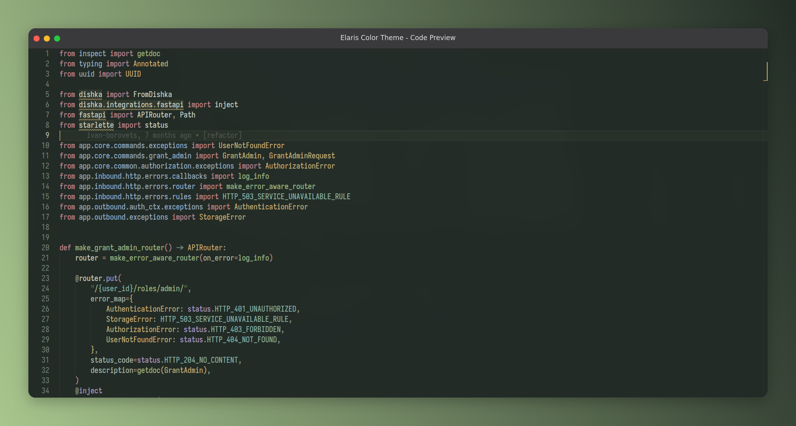

  <samp>
    Font — <a href="https://github.com/be5invis/Iosevka">Iosevka</a> 
    File Icons — <a href="https://marketplace.visualstudio.com/items?itemName=thang-nm.flow-icons">Flow Icons(flow-you)</a> 
    Demo — <a href="https://github.com/nodxide/vscode-theme-elaris">Elaris</a>
  </samp>

  <em>Less visual noise. More focus on the code.</em>

---

## Overview

Elaris is a carefully crafted editor color theme built around a simple idea: **the interface should support your work, not compete with it.**

Designed for developers who appreciate understated aesthetics and a consistent visual environment, Elaris combines deep, muted backgrounds with readable foregrounds and deliberately chosen syntax colors. Its palette aims to establish a clear visual hierarchy, helping code remain the primary focus while keeping the surrounding interface cohesive.

Rather than relying on excessive saturation or harsh contrasts between interface elements, Elaris takes a more restrained approach. Backgrounds, borders, interactive states, and syntax accents are selected to work together as parts of a unified color system.

The result is a theme designed for everyday development — from navigating large codebases to writing small scripts, reviewing changes, and working through complex problems.

## Design Philosophy

### Clarity over decoration

Every color should have a purpose. Interface elements remain visually organized without unnecessary emphasis, while syntax colors help distinguish language constructs naturally.

### Balance over intensity

The palette uses considered relationships between backgrounds, foregrounds, and accents to create a consistent visual experience without overwhelming the editor.

### Consistency across the interface

Editor surfaces, panels, borders, selections, and syntax highlighting should feel like parts of the same design system rather than independent collections of colors.

### Comfort for everyday development

A development environment is something you may look at for hours. Elaris aims for a restrained appearance that keeps attention on the work and avoids unnecessary visual clutter.

## Features

- **Refined dark aesthetic** — muted surfaces and carefully balanced foreground colors.
- **Purposeful syntax highlighting** — distinct color roles for common programming-language constructs.
- **Cohesive interface styling** — a consistent palette across editor UI elements and workbench surfaces.
- **Restrained accent colors** — emphasis where it matters without making every element compete for attention.
- **Minimal visual noise** — a clean foundation for focused development.
- **Maintainable color system** — organized theme definitions intended to support consistent updates and future refinements.

## Elaris Dark — Color Palette

A complete palette reference for the supplied **Elaris** VS Code dark theme. This document includes every distinct solid color and the intentional 8-digit alpha color variants documented from the theme JSON.

### Backgrounds & surfaces

## Backgrounds & borders

|                                                     Icon                                                      | Name                      | Token                  | HEX       | RGB               | Description                                                                              |
| :-----------------------------------------------------------------------------------------------------------: | ------------------------- | ---------------------- | --------- | ----------------- | ---------------------------------------------------------------------------------------- |
|            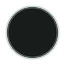            | **Forest Ink**            | `background.abyss`     | `#171D1B` | `rgb(23, 29, 27)` | The deepest forest-charcoal; reserved for title bars and the darkest interface surfaces. |
|           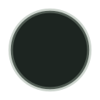           | **Deep Forest**           | `background.sidebar`   | `#1D2521` | `rgb(29, 37, 33)` | A deep green-black that gives sidebars and navigation areas a distinct layer.            |
|                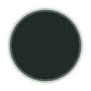                | **Canopy**                | `background.editor`    | `#222C26` | `rgb(34, 44, 38)` | The primary editor and terminal background: dark, green-tinted, and easy on the eyes.    |
|          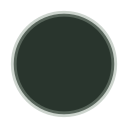          | **Moss Surface**          | `background.elevated`  | `#29352D` | `rgb(41, 53, 45)` | Elevated surfaces for widgets, menus, inputs, and completion panels.                     |
|            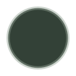            | **Moss Hover**            | `background.hover`     | `#334137` | `rgb(51, 65, 55)` | A visible but restrained hover and active surface for interactive elements.              |
|      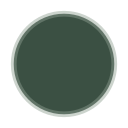      | **Forest Selection**      | `background.focus`     | `#3B5043` | `rgb(59, 80, 67)` | A stronger green surface for focused list items and keyboard navigation.                 |
| 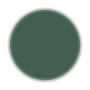 | **Deep Lichen Selection** | `background.selection` | `#435F50` | `rgb(67, 95, 80)` | A selection color for highlighting selected text and interface items.                    |
|     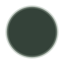     | **Understory Border**     | `border.subtle`        | `#344239` | `rgb(52, 66, 57)` | Low-emphasis separators between panels, tabs, and editor groups.                         |
|            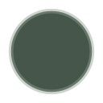            | **Pine Stone**            | `border.strong`        | `#46564A` | `rgb(70, 86, 74)` | A stronger border for inputs, widgets, focus outlines, and resizable dividers.           |

## Text & neutrals

|                                           Icon                                            | Name            | Token            | HEX       | RGB                  | Description                                                                               |
| :---------------------------------------------------------------------------------------: | --------------- | ---------------- | --------- | -------------------- | ----------------------------------------------------------------------------------------- |
| 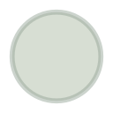 | **Soft Lichen** | `text.primary`   | `#D7DED3` | `rgb(215, 222, 211)` | Primary text with a soft sage cast, avoiding the glare of pure white.                     |
|   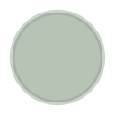   | **Pale Sage**   | `text.secondary` | `#B7C3B5` | `rgb(183, 195, 181)` | Secondary labels and supporting text; quieter than primary text while remaining readable. |
| 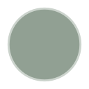 | **Silver Sage** | `text.muted`     | `#91A093` | `rgb(145, 160, 147)` | Comments, inactive labels, line numbers, and other low-priority information.              |
|   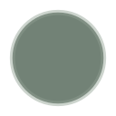   | **Dusk Sage**   | `text.dim`       | `#728276` | `rgb(114, 130, 118)` | Disabled controls and the most subdued interface details.                                 |

## Accents & syntax

|                                             Icon                                              | Name              | Token           | HEX       | RGB                  | Description                                                                                        |
| :-------------------------------------------------------------------------------------------: | ----------------- | --------------- | --------- | -------------------- | -------------------------------------------------------------------------------------------------- |
|  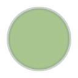  | **Lichen Green**  | `accent.moss`   | `#A8C58D` | `rgb(168, 197, 141)` | The signature Elaris accent for functions, success states, active indicators, and primary actions. |
| 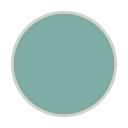 | **Oxidized Teal** | `accent.teal`   | `#7EADA5` | `rgb(126, 173, 165)` | A cool, weathered teal for properties, informational states, and secondary syntax accents.         |
|    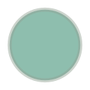    | **Quiet Mint**    | `accent.mint`   | `#8EBEAE` | `rgb(142, 190, 174)` | A lighter green-blue for links, hints, constants, and subtle semantic distinctions.                |
|    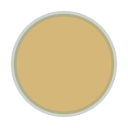    | **Soft Brass**    | `accent.brass`  | `#D5B879` | `rgb(213, 184, 121)` | A warm, muted gold for types, warnings, booleans, and the editor cursor.                           |
| 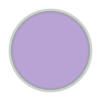 | **Mineral Lilac** | `accent.lilac`  | `#B8A3D4` | `rgb(184, 163, 212)` | A soft mineral purple for numbers, decorators, and selected syntax accents.                        |
|    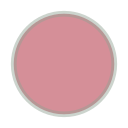    | **Dusty Rose**    | `accent.rose`   | `#D58F98` | `rgb(213, 143, 152)` | A softened rose-red for errors, control-flow keywords, and destructive states.                     |
|  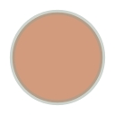  | **Muted Copper**  | `accent.copper` | `#D39B7D` | `rgb(211, 155, 125)` | An earthy orange for operators, changed lines, tags, and event-related syntax.                     |
|     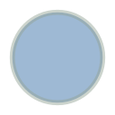     | **Mist Blue**     | `accent.blue`   | `#9EB9D4` | `rgb(158, 185, 212)` | A cool, low-saturation blue for regular expressions and namespace-related distinctions.            |

## Machine-readable palette

The structured source is [`assets/palette/elaris-palette.json`](assets/palette/elaris-palette.json). It contains the same named colors, RGB channels, descriptions, and alpha variants for scripts or future platform ports.

## Contributing

Suggestions, bug reports, and improvements are welcome. When proposing a color change, include the affected editor element, the current behavior, and the intended improvement.

Changes should preserve the overall visual identity of Elaris and avoid introducing colors solely for decoration. When possible, include a screenshot or reproducible example to make the proposed change easier to evaluate.

## License

Elaris is distributed under the license specified in [`LICENSE`](LICENSE). Review that file for the applicable terms before using, modifying, or redistributing the project.

---

  <strong>Elaris</strong>
   
  Thoughtful colors. Clearer code. A quieter workspace.

