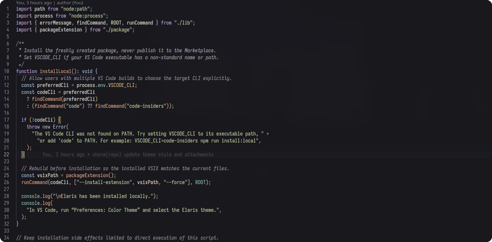

<p align="center">
  
</p>

<h1 align="center">Elaris Theme for Visual Studio Code</h1>

<p align="center">
  A considered dark theme built around deep charcoal, warm ivory, and restrained mineral accents.
</p>

<p align="center">
  <a href="https://github.com/nodxide/vscode-theme-elaris">
    
  </a>
  
  
</p>

<p align="center">
  <a href="https://github.com/nodxide/vscode-theme-elaris/stargazers">
    
  </a>
  <a href="https://github.com/nodxide/vscode-theme-elaris/blob/main/LICENSE">
    
  </a>
</p>

<!-- <p align="center">
  
</p> -->

<p align="center">
  <em>Less visual noise. More attention on the code.</em>
</p>

---

<h2 align="center">Overview</h2>

Elaris is a dark Visual Studio Code theme designed to make code structure easy to scan over long sessions. The editor uses a near-black charcoal surface and warm ivory text, while the surrounding workbench is arranged in quiet graphite layers. Thin borders and low-intensity state fills provide structure without surrounding the code with visual clutter.

Syntax colors are assigned distinct, consistent roles: lilac for keywords, copper for functions, mist blue for types, muted teal for properties, pale sage for strings, and amber for numbers and literals. Soft lime marks focus and active states. Sage green and coral communicate success and errors without making ordinary syntax compete for attention.

Elaris also carries this visual hierarchy across tabs, sidebars, completion widgets, terminal output, diagnostics, Git decorations, diffs, debugging, tests, and notebooks.

<h2 align="center">Design principles</h2>

### A layered interface

The editor is the darkest surface. Sidebars and tabs sit one level above it; panels, menus, and widgets use subtly elevated surfaces. Borders stay muted, and hover or selection states are differentiated through small changes in luminance rather than bright blocks.

### Syntax with a purpose

Keywords, callables, types, properties, strings, literals, parameters, comments, and punctuation each have a recognizable role. This makes code structure easier to identify without assigning a different accent to every token.

### Calm, functional emphasis

Lime is reserved for focus and active UI states. Teal, sage, blue, lilac, amber, and copper distinguish syntax categories; coral and sage green are primarily used for error and success states. These accents form a shared visual system across the editor and workbench.

### Built for everyday development

The theme includes workbench colors for navigation, search, suggestions, inlay hints, bracket matching, source control, diffs and merges, terminal ANSI colors, debugging, testing, and notebook cells. Syntax highlighting can vary by language grammar, semantic-token provider, and installed extensions.

<h2 align="center">Core palette</h2>

The [complete palette reference](palette/Elaris/palette.md) documents color roles, HEX values, terminal ANSI colors, and transparency usage.

<h2 align="center">Run Elaris locally</h2>

To test the theme from source, open it in a VS Code Extension Development Host.

1. Clone the repository and open it in VS Code:

   ```bash
   git clone https://github.com/nodxide/vscode-theme-elaris.git
   cd vscode-theme-elaris
   code .
   ```

2. Press **F5** or choose **Run → Start Debugging**. VS Code opens a separate Extension Development Host window.
3. In that window, open the Command Palette with **Ctrl+Shift+P** (or **Cmd+Shift+P** on macOS).
4. Run **Preferences: Color Theme** and select **Elaris**.

For packaging, local VSIX installation, or publishing, see the official [VS Code extension publishing guide](https://code.visualstudio.com/api/working-with-extensions/publishing-extension).

<h2 align="center">Contributing</h2>

Bug reports, palette feedback, and focused improvements are welcome. For visual issues, identify the affected token or workbench element, describe the current and expected behavior, and include a screenshot or minimal reproduction when possible.

When changing colors, preserve the existing hierarchy and syntax-role distinctions. Prefer refining an existing assignment over introducing a new accent without a clear functional reason. Review both syntax and workbench states to catch unintended side effects.

<h2 align="center">License</h2>

Elaris is distributed under the [MIT License](LICENSE).

---

<p align="center">
  <strong>Elaris</strong><br>
  Thoughtful colors. Clearer code. A quieter workspace.
</p>
