<h1 align="center">Elaris Color Palette</h1>

[← Back to the Elaris README](../../README.md)

## At a glance

- **Surfaces** define the editor and workbench layers.
- **Text** establishes foreground hierarchy and quiet secondary information.
- **Syntax and state accents** distinguish code constructs and interface feedback.

> The HEX values below are the original palette values and have not been changed. The theme may use transparency variants of these colors for selections, highlights, borders, and other UI states.

## 1. Surfaces

| Color                                                                                                           | Role                  | Color name        | HEX       | Purpose                                                            |
| --------------------------------------------------------------------------------------------------------------- | --------------------- | ----------------- | --------- | ------------------------------------------------------------------ |
|       | **Editor background** | Charcoal          | `#17171D` | Deepest surface; keeps the code visually dominant.                 |
|            | **Sidebar and tabs**  | Graphite          | `#1D1D26` | Separates navigation from the editor without a hard contrast jump. |
|            | **Panels**            | Slate charcoal    | `#22222C` | Gives bottom and secondary panels their own layer.                 |
| 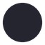 | **Widgets and menus** | Elevated graphite | `#252530` | Used for suggestions, hover cards, menus, and inputs.              |
| 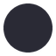     | **Hover surface**     | Soft graphite     | `#2A2A35` | Indicates interactive states without bright fills.                 |

## 2. Text

| Swatch                                                                                                         | Role               | Color name      | HEX       | Purpose                                                  |
| -------------------------------------------------------------------------------------------------------------- | ------------------ | --------------- | --------- | -------------------------------------------------------- |
| 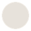        | **Primary text**   | Warm ivory      | `#E7E2DB` | Main editor and interface foreground.                    |
| 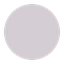 | **Secondary text** | Pale mauve-gray | `#D5CDD4` | Supporting labels and secondary content.                 |
| 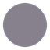          | **Muted text**     | Quiet gray      | `#87818D` | Inactive labels, line numbers, and low-priority details. |

## 3. Syntax and state accents

| Swatch                                                                                                              | Role                           | Color name       | HEX       | Purpose                                                          |
| ------------------------------------------------------------------------------------------------------------------- | ------------------------------ | ---------------- | --------- | ---------------------------------------------------------------- |
|               | **Focus and active states**    | Soft lime        | `#D0D49A` | Cursor, focus borders, active indicators, and primary actions.   |
| 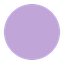   | **Keywords and decorators**    | Mineral lilac    | `#C0A5D9` | Language structure and control-flow cues.                        |
| 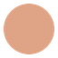       | **Functions and methods**      | Warm copper      | `#DFA486` | Makes callable names easy to identify.                           |
| 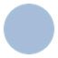          | **Types and namespaces**       | Mist blue        | `#A7BCD9` | Classes, types, interfaces, and related symbols.                 |
| 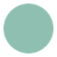   | **Properties and object keys** | Muted teal       | `#8EBFB1` | Fields, properties, links, and selected informational details.   |
| 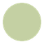                   | **Strings**                    | Pale sage        | `#C4D0A3` | String values and related text literals.                         |
| 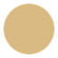         | **Numbers and literals**       | Soft amber       | `#D8B982` | Numeric values, booleans, constants, and warnings.               |
| 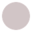                | **Parameters**                 | Warm gray        | `#D1C5C6` | Function parameters and argument names.                          |
| 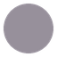           | **Comments**                   | Muted mauve-gray | `#97909B` | Deliberately quieter explanatory text.                           |
| 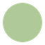        | **Success and additions**      | Sage green       | `#AFCA98` | Successful operations, tests, and added lines.                   |
| 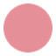         | **Errors and deletions**       | Soft coral       | `#E58F98` | Errors, failed tests, and removed lines.                         |
|  | **Operators and punctuation**  | Lavender gray    | `#B2AAB7` | Structural punctuation and operators without excessive emphasis. |

## Implementation notes

- **Base colors:** The HEX values identify the base color for each role. Individual workbench tokens may use 8-digit HEX values to add transparency.
- **Syntax rendering:** The final appearance of syntax colors can vary with the language grammar, semantic tokens, and installed extensions or language servers.
