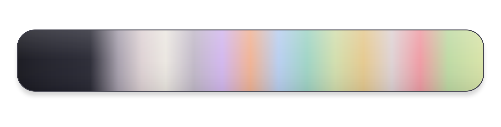

<h1 align="center">Elaris Color Palette</h1>

[← Back to the Elaris README page](../../README.md)

**At a glance**

- **Surfaces** define the editor and workbench layers.
- **Text** establishes foreground hierarchy and quieter secondary information.
- **Syntax and state accents** distinguish code constructs and interface feedback.

> This palette reflects the current Elaris brighter variant. HEX values are the base colors used by the theme; selections, highlights, borders, and other UI states may use transparency variants.

## 1. Surfaces

| Color                                                                                                           | Role                  | Color name        | HEX       | Purpose                                                            |
| --------------------------------------------------------------------------------------------------------------- | --------------------- | ----------------- | --------- | ------------------------------------------------------------------ |
|       | **Editor background** | Charcoal          | `#17171D` | Deepest surface; keeps source code visually dominant.              |
|            | **Sidebar and tabs**  | Graphite          | `#1D1D26` | Separates navigation from the editor without a hard contrast jump. |
|            | **Panels**            | Slate charcoal    | `#22222C` | Defines the lower panel and secondary workbench layer.             |
|  | **Widgets and menus** | Elevated graphite | `#252530` | Used for suggestions, hover cards, menus, and input surfaces.      |
|      | **Hover surface**     | Soft graphite     | `#2A2A35` | Marks interactive hover states without bright fills.               |

## 2. Text

| Color                                                                                                           | Role               | Color name       | HEX       | Purpose                                            |
| --------------------------------------------------------------------------------------------------------------- | ------------------ | ---------------- | --------- | -------------------------------------------------- |
|          | **Primary text**   | Warm ivory       | `#EBE7E1` | Main editor and interface foreground.              |
|  | **Secondary text** | Pale mauve-white | `#DED7DE` | Supporting labels and secondary interface content. |
|            | **Muted text**     | Quiet gray       | `#96909D` | Inactive labels and low-priority details.          |

## 3. Syntax and state accents

| Color                                                                                                                    | Role                           | Color name              | HEX       | Purpose                                                              |
| ------------------------------------------------------------------------------------------------------------------------ | ------------------------------ | ----------------------- | --------- | -------------------------------------------------------------------- |
|                | **Focus and active states**    | Luminous sage           | `#DBE4A8` | Cursor, focus borders, active indicators, and primary actions.       |
|  | **Keywords and decorators**    | Bright mineral lilac    | `#D2B7EE` | Language structure, control flow, and decorators.                    |
|            | **Functions and methods**      | Warm apricot            | `#F0B394` | Makes callable names easier to identify.                             |
|          | **Types and namespaces**       | Periwinkle mist         | `#B8CEF0` | Classes, types, interfaces, namespaces, and related symbols.         |
|      | **Properties and object keys** | Clear seafoam           | `#9FD4C5` | Fields, properties, object keys, and selected informational details. |
|                         | **Strings**                    | Soft sage               | `#D2DEAD` | String values and related text literals.                             |
|               | **Numbers and literals**       | Warm amber              | `#E5C98F` | Numeric values, booleans, constants, and warning accents.            |
|                     | **Parameters**                 | Soft mauve              | `#DED2D4` | Function parameters and argument names.                              |
|          | **Comments**                   | Bright muted mauve-gray | `#A7A0AD` | Quiet explanatory text with improved visibility.                     |
|             | **Success and additions**      | Spring sage             | `#BEDAA4` | Successful operations, passing tests, and added lines.               |
|               | **Errors and deletions**       | Soft coral              | `#EF9BA4` | Errors, failed tests, and removed lines.                             |
|     | **Operators and punctuation**  | Silver lavender         | `#C1B9C8` | Operators and structural punctuation without excessive emphasis.     |

## Implementation notes

- **Base colors:** HEX values identify the base color for each role. Individual workbench tokens may use 8-digit HEX values to add transparency.
- **Syntax rendering:** The final appearance of syntax colors can vary by language grammar, semantic highlighting, installed extensions, and language-server support.
- **Swatch assets:** Each swatch is a 96 × 96 PNG stored in `assets/colors/`; the Markdown table renders it at 24 × 24 pixels.
